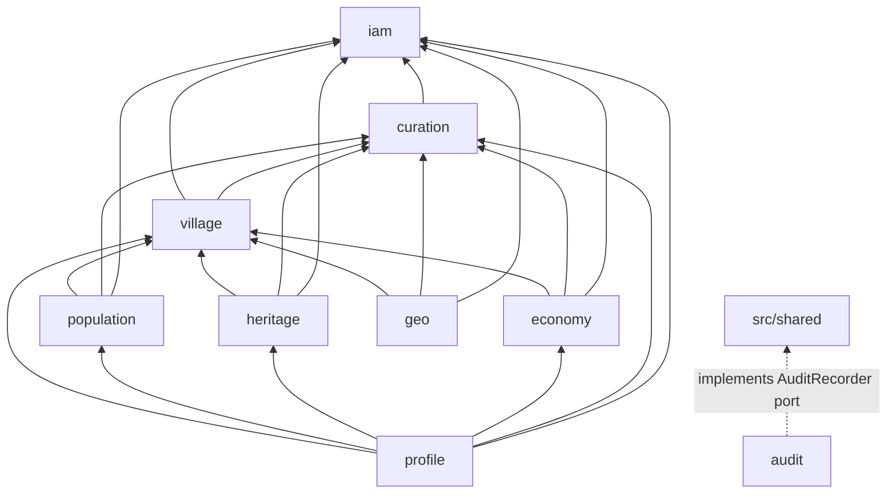

# ADR-001: Modular monolith with hexagonal modules

- **Status:** Accepted
- **Date:** 2026-10-11
- **Deciders:** Decided by Baraa (platform lead); shared with the team in the team guide on 2026-10-12.
- **Issue:** #11

## Context

- Qaryati covers many related domains: village identity, population, history and heritage, economy, sources and verification (curation), audit, users and access (iam), geocoding (geo).
- Five developers, about seven weeks (deadline 2026-12-01), each owning one or two domains.
- The project is graded on modularity, testability and controlled coupling, and the brief asks for a clean, hexagonal structure.
- One relational database is mandatory. Every write must be audited in the same transaction as the change.

We needed a structure that lets five people work in parallel without stepping on each other, keeps business rules testable without a database, and still ships as one simple deployment.

## Decision

**One NestJS deployable, split into nine business modules with hard boundaries. Inside each module, a small hexagon.** It was written down on 2026-10-11 (#1) and implemented with its enforcement in #65.

- **Modules** (`src/modules`): `iam`, `curation`, `audit`, `village`, `population`, `heritage`, `economy`, `geo`, `profile`. Each owns its tables in its own `infrastructure/persistence/schema.ts` and exposes only its `index.ts`.
- **Layers inside a module:** `web → application → domain`. `infrastructure` implements the ports that `domain` and `application` declare. `domain` is plain TypeScript: no NestJS, Drizzle, `pg`, Express, and no direct clock or UUID calls.
- **Shared code:** `src/shared/kernel` (plain TypeScript: errors, ids, `Clock`, pagination, `Versioned`, domain events, the `AuditRecorder` port) and `src/platform` (technical code: HTTP, database, logging, events). Only the kernel may reach `domain/`.
- **Composition root:** `src/app.module.ts` is the only file that imports every module's Nest module.
- **Web client:** `web/` (#61) talks to the API over HTTP only, through a client generated from `openapi.json`, and never imports from `src/`.

### Module dependency directions

An arrow means "may import the public `index.ts` of". Every module may also import `src/shared`.

| Module                                     | May import (besides `src/shared`)                                                           |
| ------------------------------------------ | ------------------------------------------------------------------------------------------- |
| `iam`                                      | none                                                                                        |
| `curation`                                 | `iam`                                                                                       |
| `audit`                                    | none; nobody imports `audit`                                                                |
| `village`                                  | `iam`, `curation`                                                                           |
| `population`, `heritage`, `economy`, `geo` | `iam`, `curation`, `village`                                                                |
| `profile`                                  | `iam`, `curation`, `village`, `population`, `heritage`, `economy`; nobody imports `profile` |

- **`village` is a base module.** It never depends on the content modules, so the graph has no cycles.
- **`profile` is read-only composition at the top:** the village details page, completeness, and the details cache. It owns no tables and nothing depends on it.
- **The calls that look backwards are inverted, not imported:**

| Need                                                      | Forbidden import                    | Solution                                                                                            |
| --------------------------------------------------------- | ----------------------------------- | --------------------------------------------------------------------------------------------------- |
| Every module writes audit entries                         | `* → audit`                         | `AuditRecorder` port in the shared kernel; `audit` implements it through DI (#20).                  |
| Curation changes the status of a claim in a content table | `curation → village/population/...` | Content modules register a `ClaimHandler` with `curation`; the dependency stays content → curation. |
| Village search filtered by product                        | `village → economy`                 | `village` search accepts `villageIds`; `economy` calls it (`economy → village`).                    |

### Runtime isolation of data

The import rules are backed by runtime isolation. Each module receives its own Drizzle handle with **only its own schema** (`DatabaseModule.forFeature(schema)`), so another module's tables do not exist for it, neither on `db.query` nor in the type system. Transactions are opened at the connection level: `@Transactional()` on a use case shares one `pg` client between all modules' handles, so several modules (a change and its audit entry) commit or roll back together without seeing each other's tables (#77). Details: [database.md](../database.md#transactions).

## Alternatives considered

| Option                                                                                        | Pros                                                         | Cons                                                                              | Why rejected                                                               |
| --------------------------------------------------------------------------------------------- | ------------------------------------------------------------ | --------------------------------------------------------------------------------- | -------------------------------------------------------------------------- |
| Application layered by technical role (controllers, services, repositories for the whole app) | Familiar, fewest files                                       | No ownership; any service reaches any table; boundaries erode                     | Fails the modularity and controlled-coupling goals.                        |
| Microservices                                                                                 | Independent deploys and scaling                              | Network calls, distributed transactions, several deployments, one database anyway | Far more cost than value for five students, one database and one deadline. |
| Clean/hexagonal layers without module boundaries                                              | Framework-free domain, testable rules                        | One big domain; modules still couple freely across the codebase                   | Solves testability but not coupling between domains or team ownership.     |
| **Modular monolith with hexagonal modules (chosen)**                                          | One process and deployment, clear ownership, testable domain | More files and interfaces; rules must be enforced                                 | Chosen.                                                                    |

## Consequences

### Positive

- One transaction covers a change and its audit entry, across modules.
- Simple deployment: one image, one process, one database (Docker Compose).
- Each member owns modules and can change them without touching others' internals.
- Domain rules run in milliseconds in unit tests, without a framework or database.
- A module could be extracted later behind its `index.ts` without rewriting its rules.

### Negative

- More files and interfaces per feature (ports, adapters, mappers).
- Module APIs (`index.ts`, ports, events) need discipline and review.
- One shared database: schema ownership must be policed, by rules and by review.
- Reaching "up" the graph needs indirection (ports, registrations, events) instead of a direct call.

### Follow-up

- #20 implements the `AuditRecorder` port in `audit`. #35 adds the `ClaimHandler` registry. #30/#36 add the product filter. #45 adds the details cache in `profile`.

## How it is enforced or verified

- **dependency-cruiser** (`npm run depcruise`, CI `quality` job), every rule an error: `no-circular`, `domain-is-framework-free`, `application-not-to-outer-layers`, `no-cross-module-internals`, `module-dependency-direction` (generated from the `ALLOWED` table, which must match [architecture.md](../architecture.md#dependency-directions)), `domain-imports-only-kernel`, `kernel-is-framework-free`, `shared-is-independent`, `reference-module-imports-no-module`, `src-not-to-tests`. Each rule was proven with a deliberate violation.
- **ESLint** in `domain/` and `application/`: no `new Date()`, `Date.now()`, `randomUUID()` or `uuid` imports; time and ids come from the injected `Clock` and `IdGenerator`.
- **Per-module schema files:** `drizzle.config.ts` collects `src/modules/*/infrastructure/persistence/schema.ts`; there is no combined schema.
- **Tests:** `test/database-module.int-spec.ts` and `test/transactions.int-spec.ts` prove, against real PostGIS, that a module cannot see another module's tables (type-level `@ts-expect-error` and runtime), also inside a shared transaction, and that two modules' writes roll back together.
- **CI:** the `quality` job runs these checks on every pull request as a required status check.

## Related

- [docs/architecture.md](../architecture.md): the full structure, rules and how to read a violation
- [docs/database.md](../database.md): module handles and the transaction design
- [docs/kernel.md](../kernel.md): the kernel and platform pieces every module uses
- [ADR-002](0002-technology-stack.md): technology stack
- Issues and PRs: #1 (bootstrap, first architecture doc), #65 (module skeletons and boundary rules), #70 and #77 (shared kernel parts 1 and 2), #11 (this ADR)
