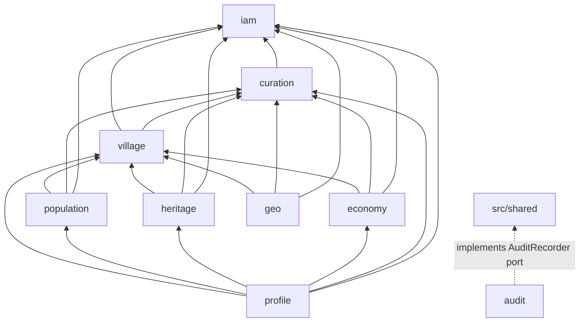
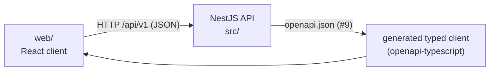
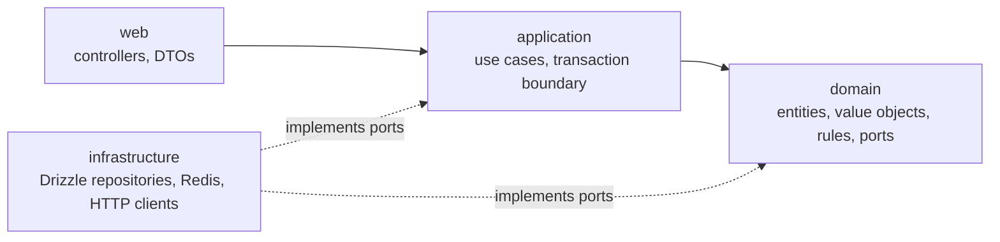

# Architecture

Qaryati is a **modular monolith**: one deployable NestJS process, split into business modules with hard boundaries. Each module is built as a small **hexagon** (ports and adapters). This page explains the structure, the rules and how they are enforced.

ADR-001 (#11) records the decision formally. This page describes the result.

## Why a modular monolith

| Option | Why not chosen |
| --- | --- |
| Microservices | Five students, one deadline (2026-12-01) and one database. Network calls, distributed transactions and several deployments would cost more time than they give back. |
| Classic layered app (controllers, services, repositories for the whole app) | Boundaries erode: any service ends up touching any table, and nobody owns anything. |
| **Modular monolith (chosen)** | One process and one deployment, but each module owns its data and exposes a small public API. A module could be extracted later without rewriting its rules. |

## Modules

Nine business modules live in `src/modules`. The kernel lives in `src/shared`, and technical cross-cutting code lives in `src/platform`.

| Module | Owner | Responsibility | Owns (tables, planned) |
| --- | --- | --- | --- |
| `iam` | Hamam | Users, registration and login, JWT, refresh tokens, roles, `PermissionChecker` | users, refresh tokens |
| `curation` | Yahya | Sources, claim columns and `ClaimPolicy`, the verification workflow, conflict detection, curation queue, the `ClaimHandler` registry | `source` |
| `audit` | Yahya | Append-only audit trail of every write, written in the same transaction as the change; audit read APIs | `audit_entry` |
| `village` | Momen | The core village record: identity, slug, names and name origins, administrative units, search, location, nearby villages, relations, publish/archive | `village`, `village_name`, `name_origin`, `admin_unit`, `village_affiliation`, `village_relation` |
| `population` | Yahya | Population records per village and year, consistency rules, statistics | population records |
| `heritage` | Ali | History overview, historical events, landmarks, cultural items | `history_overview`, `historical_event`, `landmark`, `cultural_item` |
| `economy` | Hamam | Products and facilities of each village; the product filter for village search | `product`, `village_product`, `facility` |
| `geo` | Ali | Geocoding through an external API (Nominatim), resilience, cache, suggestion queue and accept flow | geocoding suggestions |
| `profile` | Momen | Read-only composition: the village details page `GET /villages/{idOrSlug}`, `GET /villages/{id}/completeness`, and the details cache | none (Redis cache entries only) |

`src/shared` (the kernel) holds what every module needs: ids, errors, pagination, `Clock`, domain event types and the **`AuditRecorder` port interface**. It contains no module's business rules.

## Dependency directions

An arrow means "may import the public `index.ts` of". Every module may also import `src/shared`; those arrows are left out of the diagram.



| Module | May import (besides `src/shared`) |
| --- | --- |
| `iam` | none |
| `curation` | `iam` |
| `audit` | none. It implements the `AuditRecorder` port from `src/shared`. **No module imports `audit`.** |
| `village` | `iam`, `curation` |
| `population` | `iam`, `curation`, `village` |
| `heritage` | `iam`, `curation`, `village` |
| `economy` | `iam`, `curation`, `village` |
| `geo` | `iam`, `curation`, `village` |
| `profile` | `iam`, `curation`, `village`, `population`, `heritage`, `economy`. **No module imports `profile`.** |

The graph has no cycles. Dependencies point from the edges toward the core: `iam` and `curation` are the base, `village` is the core record, the content modules build on `village`, and `profile` sits on top as a pure reader.

### Why `village` does not depend on the content modules

`village` is the core record that every content module points to. If it also read population, heritage and economy to build the details page, the graph would have cycles (`village → population → village`). Then no content module could be changed or tested without the others. The details page is therefore a separate read-only module, `profile`.

- `profile` only reads, through the public facades of the other modules. It owns no tables.
- `profile` owns the details cache (#45). It is evicted after commit when a village or one of its claims changes. `profile` listens to the domain events for that and does not need any module to call it.
- Publish and archive stay in `village` (#39), because they change the village record.

### How the "backward" calls are inverted

Some features look like they need a dependency in the forbidden direction. Each one is solved with a port or a registration instead of an import:

| Need | Forbidden import | Solution |
| --- | --- | --- |
| Every module writes audit entries (#20) | `* → audit` | `src/shared` declares the `AuditRecorder` port. `audit` provides the implementation through Nest DI. Modules depend only on the port. |
| Curation verifies, disputes or rejects a claim stored in a content table (#35) | `curation → population/heritage/economy/village` | **ClaimHandler registration.** `village`, `population`, `heritage` and `economy` register a `ClaimHandler` for their claim types with curation when their module initialises. Curation calls the registered handler. The dependency stays content → curation. |
| Curation marks conflicting population records as DISPUTED (#40) | `curation → population` | Through the same `ClaimHandler` registered by `population`. |
| Village search filters by product (#30, #36) | `village → economy` | See the next section. |

### Product filter for village search

Searching villages by product (olives, grapes, ...) needs data from `economy`, but `village` must not import `economy`.

**Decision:** `village` search accepts an optional list of village ids from the caller, and `economy` is that caller.

- The `village` facade offers `search({ q, governorate, settlementStatus, sort, page, size, villageIds? })`. When `villageIds` is set, the search adds `id = ANY($villageIds)` to the same query, so filtering, sorting and pagination stay in one SQL statement.
- `economy` exposes `GET /products/{productId}/villages?q=&governorate=&sort=&page=&size=`. It reads the ids of villages that produce the product from its own `village_product` table, then calls the `village` search facade with them.
- `GET /villages` (#30) stays in `village` without a product parameter.

| Option | Why not chosen |
| --- | --- |
| `economy` exposes a query that `village` search calls | Creates `village → economy`, which is forbidden. |
| A product filter in a `profile` list endpoint | `profile` would need its own list route next to `GET /villages`, and it would duplicate search and pagination. It also breaks "profile is read-only composition of one village". |
| **`village` search takes `villageIds`; `economy` calls it (chosen)** | Uses an already allowed direction (`economy → village`), adds one optional parameter and one route, and keeps search logic in one place. |

Cost: the id list is passed in memory. That is fine at our scale (hundreds of villages per product). If it ever grows large, the same facade can take a subquery instead. ADR-001 (#11) finalises this decision.

## Web client (`web/`)

`web/` holds an internal web client for the team and the demo (issues #61–#64, milestone UI). It is not graded.



- **HTTP only.** `web/` talks to the API over HTTP, like any other client. It never imports from `src/`: no shared DTOs, entities or helpers.
- **Typed by contract, not by imports.** The API publishes `openapi.json` (#9). `web/` generates its request and response types from that file. If the API changes, the client's types change with the contract, and nobody writes request types by hand.
- **Separate project.** `web/` has its own `package.json`, lint, typecheck, tests and CI job (the job runs only when `web/` changes). The backend dependency-cruiser rules do not cover `web/`.
- **Configuration.** The client reads `API_BASE_URL` from its own config. The API's CORS allow-list contains the client's dev origin.

Why: this keeps the API the only source of truth and avoids hidden coupling. A client that imports backend code would break the module boundaries above and couple both deploys. The cost is a generation step whenever the API contract changes.

## Inside a module: hexagonal layers



```
src/modules/<module>/
  index.ts            public API: facades, DTOs, event types
  <module>.module.ts  Nest module wiring ports to adapters
  web/                HTTP: controllers, request/response DTOs, Swagger decorators
  application/        use cases; opens and commits the transaction
  domain/             plain TypeScript: entities, value objects, rules, repository ports
  infrastructure/     adapters: persistence/schema.ts, repositories, Redis, HTTP clients
```

| Layer | May import | Must not import |
| --- | --- | --- |
| `web` | `application`, own `domain` types, `src/shared` | `infrastructure` |
| `application` | `domain`, `src/shared`, other modules' `index.ts` (per the direction table) | `web`, `infrastructure` |
| `domain` | `src/shared` (framework-free parts) | `@nestjs/*`, `drizzle-orm`, `pg`, `ioredis`, `express`, `web`, `application`, `infrastructure` |
| `infrastructure` | `domain`, `application` (to implement ports), `src/platform` | `web` |

**Why:** the domain holds the business rules: claim transitions, population consistency, self-verification. Without a framework or a database these rules run in milliseconds in unit tests. Adapters can change without touching the rules, for example the Nominatim adapter versus a stub. The cost is more files and interfaces per feature.

## Rules

1. **Cross-module access goes only through `index.ts` or domain events,** and only in the directions in the table above. A module never imports another module's repositories, tables, entities or internal services.
2. **Each module owns its tables.** Each module declares its tables in `src/modules/<m>/infrastructure/persistence/schema.ts`. Nobody edits another module's schema file.
3. **`src/shared` is the kernel.** It must not import from `src/modules` or `src/platform`.
4. **`src/platform` holds technical cross-cutting code:** health, database connection, config wiring. It contains no business rules.
5. **The composition root is exempt.** `src/app.module.ts` imports every module's Nest module to start the app. This is the only place that does.
6. **Facts are claims.** Every fact has a source, an author and a verification status. Corrections add a new claim; they never overwrite a fact in place. This applies from P1 on (#16).

## Enforcement

dependency-cruiser checks these rules (`.dependency-cruiser.cjs`, added in #2). All rules are **errors**:

| Rule | What it forbids |
| --- | --- |
| `no-circular` | Any import cycle |
| `domain-is-framework-free` | `src/modules/*/domain` importing `@nestjs`, `drizzle-orm`, `pg`, `ioredis`, `express`, or anything under `web`, `application` or `infrastructure` |
| `application-not-to-outer-layers` | `application` importing `web` or `infrastructure` |
| `no-cross-module-internals` | A file in module A importing module B through anything other than `src/modules/B/index.ts` |
| `module-dependency-direction` | A file in module A importing module B when B is not in A's row of the direction table. This includes any import of `audit` or `profile` from another module. |
| `shared-is-independent` | `src/shared` importing `src/modules` or `src/platform` |

`src/app.module.ts` is excluded from the module rules (rule 5). The CI `quality` job runs dependency-cruiser on every pull request as a required status check (#4).

#2 adds the configuration file, proves each rule fails on a deliberate violation, and explains how to read a violation.
