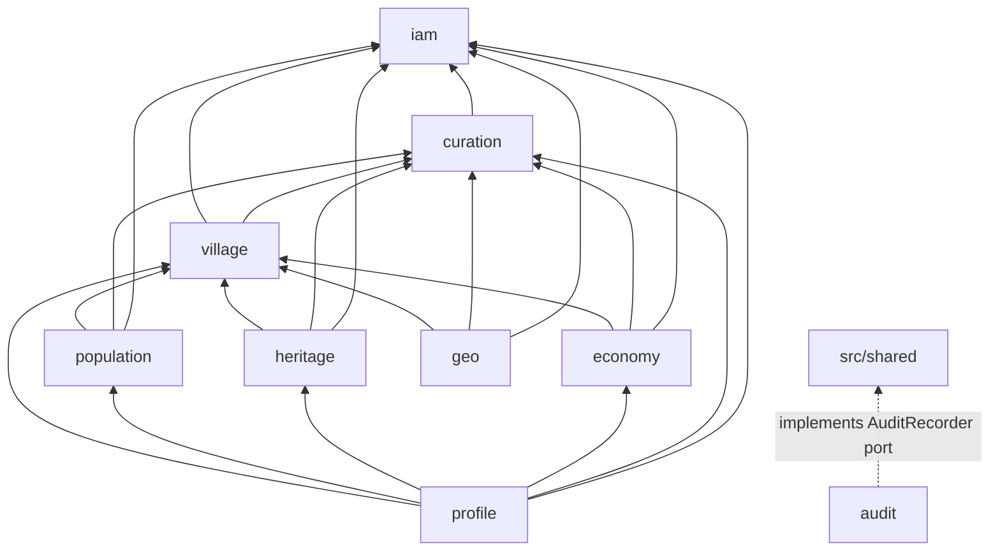
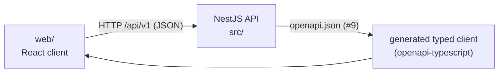
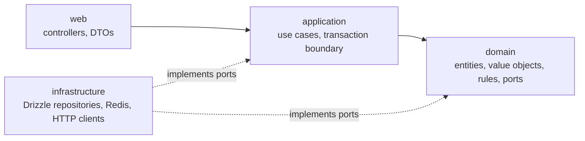
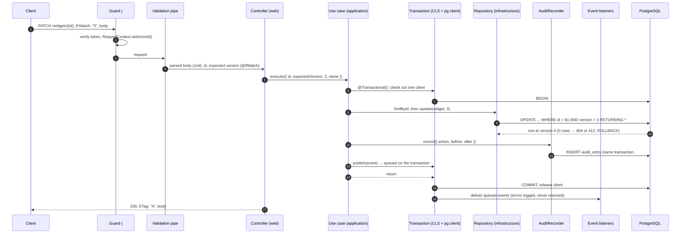

# Architecture

Qaryati is a **modular monolith**: one deployable NestJS process, split into business modules with hard boundaries. Each module is built as a small **hexagon** (ports and adapters). This page explains the structure, the rules and how they are enforced.

The decision, its context and the alternatives are recorded in [ADR-001](adr/0001-modular-monolith-hexagonal-modules.md). This page describes the result.

## Why a modular monolith

| Option                                                                      | Why not chosen                                                                                                                                                       |
| --------------------------------------------------------------------------- | -------------------------------------------------------------------------------------------------------------------------------------------------------------------- |
| Microservices                                                               | Five students, one deadline (2026-12-01) and one database. Network calls, distributed transactions and several deployments would cost more time than they give back. |
| Classic layered app (controllers, services, repositories for the whole app) | Boundaries erode: any service ends up touching any table, and nobody owns anything.                                                                                  |
| **Modular monolith (chosen)**                                               | One process and one deployment, but each module owns its data and exposes a small public API. A module could be extracted later without rewriting its rules.         |

## Modules

Nine business modules live in `src/modules`. The kernel lives in `src/shared/kernel`, and technical cross-cutting code lives in `src/platform` (see [Kernel and platform](#kernel-and-platform)).

| Module       | Owner | Responsibility                                                                                                                                       | Owns (tables, planned)                                                                            |
| ------------ | ----- | ---------------------------------------------------------------------------------------------------------------------------------------------------- | ------------------------------------------------------------------------------------------------- |
| `iam`        | Hamam | Users, registration and login, JWT, refresh tokens, roles, `PermissionChecker`                                                                       | users, refresh tokens                                                                             |
| `curation`   | Yahya | Sources, claim columns and `ClaimPolicy`, the verification workflow, conflict detection, curation queue, the `ClaimHandler` registry                 | `source`                                                                                          |
| `audit`      | Yahya | Append-only audit trail of every write, written in the same transaction as the change; audit read APIs                                               | `audit_entry`                                                                                     |
| `village`    | Momen | The core village record: identity, slug, names and name origins, administrative units, search, location, nearby villages, relations, publish/archive | `village`, `village_name`, `name_origin`, `admin_unit`, `village_affiliation`, `village_relation` |
| `population` | Yahya | Population records per village and year, consistency rules, statistics                                                                               | population records                                                                                |
| `heritage`   | Ali   | History overview, historical events, landmarks, cultural items                                                                                       | `history_overview`, `historical_event`, `landmark`, `cultural_item`                               |
| `economy`    | Hamam | Products and facilities of each village; the product filter for village search                                                                       | `product`, `village_product`, `facility`                                                          |
| `geo`        | Ali   | Geocoding through an external API (Nominatim), resilience, cache, suggestion queue and accept flow                                                   | geocoding suggestions                                                                             |
| `profile`    | Momen | Read-only composition: the village details page `GET /villages/{idOrSlug}`, `GET /villages/{id}/completeness`, and the details cache                 | none (Redis cache entries only)                                                                   |

`src/shared/kernel` holds what every module needs: ids, errors, pagination, `Clock`, `Versioned`, domain event types and the **`AuditRecorder` port interface**. It contains no module's business rules.

## Dependency directions

An arrow means "may import the public `index.ts` of". Every module may also import `src/shared`; those arrows are left out of the diagram.



| Module       | May import (besides `src/shared`)                                                                   |
| ------------ | --------------------------------------------------------------------------------------------------- |
| `iam`        | none                                                                                                |
| `curation`   | `iam`                                                                                               |
| `audit`      | none. It implements the `AuditRecorder` port from `src/shared`. **No module imports `audit`.**      |
| `village`    | `iam`, `curation`                                                                                   |
| `population` | `iam`, `curation`, `village`                                                                        |
| `heritage`   | `iam`, `curation`, `village`                                                                        |
| `economy`    | `iam`, `curation`, `village`                                                                        |
| `geo`        | `iam`, `curation`, `village`                                                                        |
| `profile`    | `iam`, `curation`, `village`, `population`, `heritage`, `economy`. **No module imports `profile`.** |

The graph has no cycles. Dependencies point from the edges toward the core: `iam` and `curation` are the base, `village` is the core record, the content modules build on `village`, and `profile` sits on top as a pure reader.

### Why `village` does not depend on the content modules

`village` is the core record that every content module points to. If it also read population, heritage and economy to build the details page, the graph would have cycles (`village → population → village`). Then no content module could be changed or tested without the others. The details page is therefore a separate read-only module, `profile`.

- `profile` only reads, through the public facades of the other modules. It owns no tables.
- `profile` owns the details cache (#45). It is evicted after commit when a village or one of its claims changes. `profile` listens to the domain events for that and does not need any module to call it.
- Publish and archive stay in `village` (#39), because they change the village record.

### How the "backward" calls are inverted

Some features look like they need a dependency in the forbidden direction. Each one is solved with a port or a registration instead of an import:

| Need                                                                           | Forbidden import                                 | Solution                                                                                                                                                                                                                                                      |
| ------------------------------------------------------------------------------ | ------------------------------------------------ | ------------------------------------------------------------------------------------------------------------------------------------------------------------------------------------------------------------------------------------------------------------- |
| Every module writes audit entries (#20)                                        | `* → audit`                                      | `src/shared` declares the `AuditRecorder` port. `audit` provides the implementation through Nest DI. Modules depend only on the port.                                                                                                                         |
| Curation verifies, disputes or rejects a claim stored in a content table (#35) | `curation → population/heritage/economy/village` | **ClaimHandler registration.** `village`, `population`, `heritage` and `economy` register a `ClaimHandler` for their claim types with curation when their module initialises. Curation calls the registered handler. The dependency stays content → curation. |
| Curation marks conflicting population records as DISPUTED (#40)                | `curation → population`                          | Through the same `ClaimHandler` registered by `population`.                                                                                                                                                                                                   |
| Village search filters by product (#30, #36)                                   | `village → economy`                              | See the next section.                                                                                                                                                                                                                                         |

### Product filter for village search

Searching villages by product (olives, grapes, ...) needs data from `economy`, but `village` must not import `economy`.

**Decision:** `village` search accepts an optional list of village ids from the caller, and `economy` is that caller.

- The `village` facade offers `search({ q, governorate, settlementStatus, sort, page, size, villageIds? })`. When `villageIds` is set, the search adds `id = ANY($villageIds)` to the same query, so filtering, sorting and pagination stay in one SQL statement.
- `economy` exposes `GET /products/{productId}/villages?q=&governorate=&sort=&page=&size=`. It reads the ids of villages that produce the product from its own `village_product` table, then calls the `village` search facade with them.
- `GET /villages` (#30) stays in `village` without a product parameter.

| Option                                                               | Why not chosen                                                                                                                                                                   |
| -------------------------------------------------------------------- | -------------------------------------------------------------------------------------------------------------------------------------------------------------------------------- |
| `economy` exposes a query that `village` search calls                | Creates `village → economy`, which is forbidden.                                                                                                                                 |
| A product filter in a `profile` list endpoint                        | `profile` would need its own list route next to `GET /villages`, and it would duplicate search and pagination. It also breaks "profile is read-only composition of one village". |
| **`village` search takes `villageIds`; `economy` calls it (chosen)** | Uses an already allowed direction (`economy → village`), adds one optional parameter and one route, and keeps search logic in one place.                                         |

Cost: the id list is passed in memory. That is fine at our scale (hundreds of villages per product). If it ever grows large, the same facade can take a subquery instead. [ADR-001](adr/0001-modular-monolith-hexagonal-modules.md) records this decision.

## Web client (`web/`)

`web/` holds an internal web client for the team and the demo (issues #61–#64, milestone UI). It is not graded.



- **HTTP only.** `web/` talks to the API over HTTP, like any other client. It never imports from `src/`: no shared DTOs, entities or helpers.
- **Typed by contract, not by imports.** The API publishes `openapi.json` (#9). `web/` generates its request and response types from that file. If the API changes, the client's types change with the contract, and nobody writes request types by hand.
- **Separate project.** `web/` has its own `package.json`, lint, typecheck, tests and CI job (the job runs only when `web/` changes). The backend dependency-cruiser rules do not cover `web/`.
- **Configuration.** The client reads `API_BASE_URL` from its own config. The API's CORS allow-list contains the client's dev origin.

Why: this keeps the API the only source of truth and avoids hidden coupling. A client that imports backend code would break the module boundaries above and couple both deploys. The cost is a generation step whenever the API contract changes.

## Authentication boundary (#10)

IAM verifies local RS256 access tokens and exports the framework-free `PermissionChecker`, trusted identity/role types, HTTP decorators and a test token issuer through `index.ts`. It imports no business module. IAM now owns user_account and refresh_token (#14), with public registration/login; refresh/logout and token rotation remain #18.

Global authentication and role guards are registered by IAM. The verifier adapter loads matching RSA secret files once at startup; the HTTP guard depends on an application port and sets the existing `RequestContext` actor only after verification. One uppercase role is carried by each token, with `ADMIN >= EDITOR >= CONTRIBUTOR`. Role checks return booleans; the HTTP guards raise exceptions mapped by the existing ProblemDetails filter.

The `Public` decorator and its metadata live in platform HTTP so health does not depend on IAM; IAM re-exports the decorator for business modules. OpenAPI reads that shared metadata without importing IAM. The module directions and dependency-cruiser rules are unchanged.

## Inside a module: hexagonal layers



```
src/modules/<module>/
  index.ts            public API: facades, DTOs, event types
  <module>.module.ts  Nest module wiring ports to adapters
  web/                HTTP: controllers, request/response DTOs, Swagger decorators
  application/        use cases; opens and commits the transaction
  domain/             plain TypeScript: entities, value objects, rules, repository ports
  infrastructure/     adapters: persistence/schema.ts, repositories, Redis, HTTP clients
```

| Layer            | May import                                                                         | Must not import                                                                                                |
| ---------------- | ---------------------------------------------------------------------------------- | -------------------------------------------------------------------------------------------------------------- |
| `web`            | `application`, own `domain` types, `src/shared/kernel`, `src/platform/http`        | `infrastructure`                                                                                               |
| `application`    | `domain`, `src/shared/kernel`, other modules' `index.ts` (per the direction table) | `web`, `infrastructure`                                                                                        |
| `domain`         | `src/shared/kernel` only                                                           | `@nestjs/*`, `drizzle-orm`, `pg`, `ioredis`, `express`, `src/platform`, `web`, `application`, `infrastructure` |
| `infrastructure` | `domain`, `application` (to implement ports), `src/platform`                       | `web`                                                                                                          |

### A write request, end to end

What happens when a client changes something, for example `PATCH /api/v1/widgets/{id}` in the reference module ([kernel.md](kernel.md#build-a-new-endpoint-in-10-steps)):



Any throw between `BEGIN` and `COMMIT` rolls everything back, including the audit entry, and the queued events are dropped. The exception filter then answers with a problem response.

**Why:** the domain holds the business rules: claim transitions, population consistency, self-verification. Without a framework or a database these rules run in milliseconds in unit tests. Adapters can change without touching the rules, for example the Nominatim adapter versus a stub. The cost is more files and interfaces per feature.

## Rules

1. **Cross-module access goes only through `index.ts` or domain events,** and only in the directions in the table above. A module never imports another module's repositories, tables, entities or internal services.
2. **Each module owns its tables.** Each module declares its tables in `src/modules/<m>/infrastructure/persistence/schema.ts`. Nobody edits another module's schema file.
3. **`src/shared/kernel` is the kernel.** It is plain TypeScript with no npm packages, and must not import from `src/modules` or `src/platform`.
4. **`src/platform` holds technical cross-cutting code:** health, HTTP conventions (problem filter, validation pipe, request ID), logging, the database connection (`DatabaseModule`, the migration runner), and the runtime implementations of kernel ports (`SystemClock`, the UUIDv7 generator). It contains no business rules. Environment schemas live in `src/config`, the only code that reads `process.env` ([configuration.md](configuration.md)).
5. **The composition root is exempt.** `src/app.module.ts` imports every module's Nest module to start the app. This is the only place that does.
6. **Facts are claims.** Every fact has a source, an author and a verification status. Corrections add a new claim; they never overwrite a fact in place. This applies from P1 on (#16).

## Kernel and platform

Shared code is split by one question: **may domain code use it?**

| Folder              | Contents                                                                                                                                                                                                                                                                          | Dependencies                               | Imported by                                                       |
| ------------------- | --------------------------------------------------------------------------------------------------------------------------------------------------------------------------------------------------------------------------------------------------------------------------------- | ------------------------------------------ | ----------------------------------------------------------------- |
| `src/shared/kernel` | `DomainError` and its categories, the error code catalogue, `Clock`, `Id`/`IdGenerator`, `Page<T>` and pagination types, `Versioned`, `DomainEvent` and the `DomainEventPublisher` port, the `AuditRecorder` port                                                                 | none (plain TS)                            | every layer of every module, `domain/` included                   |
| `src/platform`      | `http/` (filter, pipe, query schemas, request ID, ETag/If-Match, Swagger), `context/` (request context), `logging/`, `database/` (pool, module handles, transactions, versioned writes), `events/`, `audit/` (placeholder until #20), `kernel/` (port implementations), `health/` | NestJS, Drizzle, pino, nestjs-cls, Swagger | `web/` (only `platform/http`), `infrastructure/`, the module file |

The kernel declares a port (`Clock`, `IdGenerator`, `DomainEventPublisher`, `AuditRecorder`) and its injection token; `src/platform` (or, for `AuditRecorder`, the audit module from #20) provides the implementation. Domain code therefore depends on an interface it can fake in a unit test (`FixedClock`, `SequentialIdGenerator`), never on Nest or a library. How to use each piece: [kernel.md](kernel.md).

## Enforcement

dependency-cruiser checks these rules on every `npm run depcruise`. The configuration is in [`.dependency-cruiser.cjs`](../.dependency-cruiser.cjs). All rules are **errors**:

| Rule                                 | What it forbids                                                                                                                                              |
| ------------------------------------ | ------------------------------------------------------------------------------------------------------------------------------------------------------------ |
| `no-circular`                        | Any import cycle                                                                                                                                             |
| `domain-is-framework-free`           | `src/modules/*/domain` importing `@nestjs`, `drizzle-orm`, `pg`, `ioredis`, `express`, or anything under `web`, `application` or `infrastructure`            |
| `application-not-to-outer-layers`    | `application` importing `web` or `infrastructure`                                                                                                            |
| `no-cross-module-internals`          | A file in module A importing module B through anything other than `src/modules/B/index.ts`                                                                   |
| `module-dependency-direction`        | A file in module A importing module B when B is not in A's row of the direction table. This includes any import of `audit` or `profile` from another module. |
| `domain-imports-only-kernel`         | `src/modules/*/domain` importing anything in `src/shared` or `src/platform` other than `src/shared/kernel`                                                   |
| `kernel-is-framework-free`           | `src/shared/kernel` importing any npm package (NestJS, Drizzle, pg, uuid, ...)                                                                               |
| `shared-is-independent`              | `src/shared` importing `src/modules` or `src/platform`                                                                                                       |
| `reference-module-imports-no-module` | `test/reference-module` importing anything under `src/modules`                                                                                               |
| `src-not-to-tests`                   | Anything in `src/` importing from `test/`                                                                                                                    |

How the configuration works:

- **One table drives the direction rules.** `ALLOWED` at the top of `.dependency-cruiser.cjs` lists, for each module, the modules it may import. The file generates one `module-dependency-direction` rule per module from it. That table and the "Dependency directions" table on this page must stay identical. Changing a direction means changing both, in the same PR, with a reason (and an ADR if it changes the design).
- **Type-only imports count** (`tsPreCompilationDeps: true`). `import type { ... } from 'drizzle-orm'` in a domain file is still a violation, because the domain would still be coupled to Drizzle.
- **Packages that are not installed yet are caught too.** `domain-is-framework-free` matches both `node_modules/<pkg>` and the bare package name, so `drizzle-orm` is blocked in domain code even before #3 installs it.
- **`src/` and the reference module are checked.** `npm run depcruise` cruises `src` and `test/reference-module`. The layer rules (`domain-is-framework-free`, `application-not-to-outer-layers`, `domain-imports-only-kernel`) match both `src/modules/<m>/` and `test/reference-module/`, so the template the team copies obeys the same rules as a real module. `src/app.module.ts` is outside `src/modules`, so the module rules do not apply to it (rule 5). The future `web/` client (#61) is outside `src/` and has its own tooling.
- The CI `quality` job runs dependency-cruiser on every pull request as a required status check (#4).

Each rule was proven by adding a deliberate violation, checking that `npm run depcruise` failed with that rule's name, and removing it: the first six in #2, `domain-imports-only-kernel` and `kernel-is-framework-free` in #9, and in #9 part 2 the layer rules on the reference module plus `reference-module-imports-no-module` and `src-not-to-tests`.

ESLint adds one rule that dependency-cruiser cannot express, because it is about calls rather than imports: in `src/modules/*/domain` and `src/modules/*/application` (and the same folders of `test/reference-module`), `new Date()`, `Date.now()`, `randomUUID()` and imports of `uuid` are errors. Business code gets time and ids from `CLOCK` and `ID_GENERATOR` ([kernel.md](kernel.md#current-time-and-new-ids)). `new Date(value)`, which parses a value, stays allowed.

### Reading a violation

```text
  error module-dependency-direction: src/modules/village/application/zz-uc.ts → src/modules/population/index.ts

✘ 1 dependency violations (1 errors, 0 warnings). 26 modules, 29 dependencies cruised.
```

The line gives: the **rule name**, the **importing file** (left of `→`) and the **imported file** (right). The rule's `comment` in `.dependency-cruiser.cjs` explains the intent. To see every rule with its comment, read the file. The usual fixes:

| Rule                              | Usual fix                                                                                                                                                                 |
| --------------------------------- | ------------------------------------------------------------------------------------------------------------------------------------------------------------------------- |
| `no-circular`                     | Move the shared piece into one of the two files, or into a third file both import. Across modules, a cycle means the dependency direction is wrong.                       |
| `domain-is-framework-free`        | Declare a port (interface) in `domain/` and implement it in `infrastructure/`.                                                                                            |
| `application-not-to-outer-layers` | Let the use case take plain input and return plain output. The controller maps DTOs, and the adapter is injected through its port.                                        |
| `no-cross-module-internals`       | Export what you need from the other module's `index.ts` (a facade or a DTO, never a repository or a table) and import it from there.                                      |
| `module-dependency-direction`     | Invert the call: a port in `src/shared`, a registration (like `ClaimHandler`), or a domain event. If the direction itself is wrong, discuss it before changing `ALLOWED`. |
| `domain-imports-only-kernel`      | Declare a port in `domain/` and implement it in `infrastructure/` with the platform code, or move the plain type you need into `src/shared/kernel`.                       |
| `kernel-is-framework-free`        | Keep the interface and token in the kernel and put the implementation that needs the package in `src/platform` (like `UuidV7IdGenerator`).                                |
| `shared-is-independent`           | Move the code into the module that needs it, or move the type it needs down into `src/shared`.                                                                            |

## Imports

- **Relative imports, no path aliases.** `@shared/*`-style aliases would have to be wired into TypeScript, Jest and the compiled output (`nest build` does not rewrite them). That is three configurations to keep in sync, for shorter import lines. Relative paths work everywhere unchanged, and dependency-cruiser checks the real file paths either way.
- Cross-module imports point at the module folder (`../../village`), which resolves to its `index.ts`.
