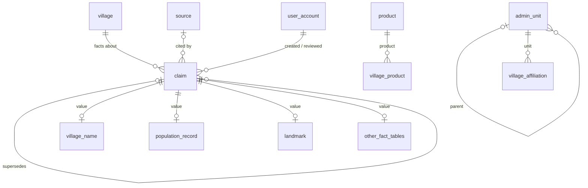

# Qaryati data model: claims

Status: accepted (ADR-003). Applies to every table that stores a fact about a village.

## The one idea

Everything we know about a village is a **claim**: a value, from a source, reviewed by someone.

- One table, **`claim`**, holds what every fact has in common: which village, which question it answers, the source, the review state, who wrote it, who reviewed it.
- Small **fact tables** hold only the typed value (a population number, a name, a point on the map). Each fact row is exactly one claim.
- Each claim answers a **question**, identified by `group_key` (for example "population of village X in 1945, census"). A question can have many claims (sources disagree), but **at most one preferred claim**. The preferred claim is the published answer.

**Public readers see exactly the preferred claims.** Everything else (unverified, disputed, rejected, older verified values) stays as history and as evidence.

This puts provenance, review and conflicts in one place, instead of copying the same columns, indexes, queue queries and endpoints into thirteen tables.



## What the database enforces, and what the code enforces

**Rule for the whole project:** the database guards the _shape and integrity_ of the data; the domain code owns the _business rules_. A business rule changing must never require a migration.

The database enforces only:

1. **Identity and relationships:** primary keys, foreign keys (with an explicit `ON DELETE`), `NOT NULL` on columns that must always exist.
2. **Uniqueness that the code cannot guarantee under concurrency:** unique slug, unique email, one published answer per question, no duplicate claim from the same source.
3. **Structural type safety:** the composite foreign key that ties a fact row to a claim of its own type.
4. **Two core rules of the project that never change:** a published claim is verified; a verified claim has a source.

Everything else lives in `domain/` as plain TypeScript, with unit tests: allowed values (statuses, types, kinds, languages), ranges (years, elevation, area), text lengths and formats (slug, language code), conditional rules (an authority type only for a local authority), and the whole workflow (four eyes, review notes, who may edit what, when a claim becomes preferred). Allowed values are `as const` arrays exported from the owning module, so the API schemas and the docs read from the same list.

Columns that hold one of a set of values are plain `text` in the database. Adding a value is a code change, not a migration.

## Tables and owners

| Table                                                                                                           | Owner module | Kind                                 |
| --------------------------------------------------------------------------------------------------------------- | ------------ | ------------------------------------ |
| `village`                                                                                                       | village      | identity + two projections           |
| `admin_unit`                                                                                                    | village      | reference data                       |
| `product`                                                                                                       | economy      | reference data                       |
| `source`                                                                                                        | curation     | reference data (#13)                 |
| `claim`                                                                                                         | curation     | provenance and review for every fact |
| `village_name`, `name_origin`, `village_affiliation`, `village_location`, `village_measure`, `village_relation` | village      | facts                                |
| `population_record`                                                                                             | population   | facts                                |
| `history_overview`, `historical_event`, `landmark`, `cultural_item`                                             | heritage     | facts                                |
| `village_product`, `facility`                                                                                   | economy      | facts                                |
| `user_account`, `refresh_token`                                                                                 | iam          | accounts                             |
| `audit_entry`                                                                                                   | audit        | append-only action log               |

## `claim`

| Column                                | Type        | Rule                                                                                                                  |
| ------------------------------------- | ----------- | --------------------------------------------------------------------------------------------------------------------- |
| `id`                                  | uuid        | primary key (UUIDv7)                                                                                                  |
| `claim_type`                          | text        | NOT NULL; allowed values in code (claim-type list below)                                                              |
| `village_id`                          | uuid        | NOT NULL, FK `village` ON DELETE RESTRICT                                                                             |
| `group_key`                           | text        | NOT NULL, the question this claim answers (format per type, below)                                                    |
| `value_hash`                          | text        | NOT NULL; SHA-256 hex of the canonical value                                                                          |
| `source_id`                           | uuid        | nullable, FK `source` ON DELETE RESTRICT                                                                              |
| `source_locator`                      | text        | nullable: page, table or URL fragment inside the source                                                               |
| `status`                              | text        | NOT NULL, default `UNVERIFIED`; allowed values in code: `UNVERIFIED`, `VERIFIED`, `DISPUTED`, `REJECTED`, `WITHDRAWN` |
| `is_preferred`                        | boolean     | NOT NULL, default false                                                                                               |
| `supersedes_id`                       | uuid        | nullable, FK `claim` ON DELETE RESTRICT: the claim this one corrects                                                  |
| `created_by`                          | uuid        | NOT NULL, FK `user_account` ON DELETE RESTRICT                                                                        |
| `reviewed_by`                         | uuid        | nullable, FK `user_account` ON DELETE RESTRICT                                                                        |
| `reviewed_at`                         | timestamptz | nullable                                                                                                              |
| `review_note`                         | text        | nullable                                                                                                              |
| `version`, `created_at`, `updated_at` |             | kernel `versionColumns()`; **no `deleted_at`**                                                                        |

### Rules the database enforces (only these)

```sql
-- target for the typed foreign keys of the fact tables
UNIQUE (id, claim_type)

-- the two core rules that never change
CHECK (NOT is_preferred OR status = 'VERIFIED')        -- only a verified claim is published
CHECK (status <> 'VERIFIED' OR source_id IS NOT NULL)  -- nothing is verified without a source
```

### Rules the domain enforces (in `curation/domain`, unit-tested)

- allowed `status` values and legal transitions
- four eyes: the reviewer is not the author
- `reviewed_by` and `reviewed_at` are set exactly when a claim is reviewed
- rejecting or disputing needs a note
- population claims cite a source from the start
- a claim cannot supersede itself
- only the author edits or withdraws, and only while `UNVERIFIED`

### Indexes

```sql
-- one published answer per question
CREATE UNIQUE INDEX claim_one_preferred ON claim (group_key) WHERE is_preferred;

-- the same value from the same source cannot be entered twice
CREATE UNIQUE INDEX claim_no_duplicate ON claim (group_key, value_hash, source_id) NULLS NOT DISTINCT
  WHERE status <> 'WITHDRAWN';

-- review queue
CREATE INDEX claim_review_queue ON claim (status, created_at) WHERE status IN ('UNVERIFIED','DISPUTED');

-- village page: published facts by type
CREATE INDEX claim_village_published ON claim (village_id, claim_type) WHERE is_preferred;

-- conflict detection
CREATE INDEX claim_group ON claim (group_key);

-- foreign keys
CREATE INDEX ON claim (source_id);  CREATE INDEX ON claim (supersedes_id);
CREATE INDEX ON claim (created_by); CREATE INDEX ON claim (reviewed_by);
```

## Fact tables: one pattern for all

```sql
CREATE TABLE population_record (
  claim_id        uuid PRIMARY KEY,
  claim_type      text NOT NULL DEFAULT 'POPULATION' CHECK (claim_type = 'POPULATION'),
  FOREIGN KEY (claim_id, claim_type) REFERENCES claim (id, claim_type) ON DELETE CASCADE,

  population      integer  NOT NULL,
  reference_year  smallint NOT NULL,
  count_type      text     NOT NULL
);
```

- `claim_id` is the primary key, so one fact row per claim.
- The composite foreign key on `(claim_id, claim_type)` makes it impossible to attach a population row to a name claim. The constant `CHECK (claim_type = '...')` is structural and never changes.
- Value rules (population ≥ 0, year range, allowed count types) are in the population domain, not in the table.
- No `village_id`, no status, no source: those live on `claim`.
- A fact row is **immutable once its claim is reviewed**. The author may edit it only while it is `UNVERIFIED`. A later correction is a new claim with `supersedes_id`.

## Claim types

`group_key` uses `|` as separator and always starts with the type prefix and the village id. Each owning module builds it with one pure function in its `domain/`, with unit tests. `value_hash` is SHA-256 of a canonical string of the value fields (names pass through `normalizeName` first, numbers as plain digits, points rounded to 5 decimals).

| `claim_type`       | Fact table and value                                                       | `group_key` (the question)                                                          | Hash of                    | Owner      |
| ------------------ | -------------------------------------------------------------------------- | ----------------------------------------------------------------------------------- | -------------------------- | ---------- |
| `VILLAGE_NAME`     | `village_name`: name, name_normalized, lang, name_type, period years       | `CURRENT`: `name\|v\|lang\|current`; other types: `name\|v\|lang\|type\|normalized` | normalized name + period   | village    |
| `NAME_ORIGIN`      | `name_origin`: meaning, origin_language, explanation                       | `origin\|v`                                                                         | the three fields           | village    |
| `AFFILIATION`      | `village_affiliation`: admin_unit_id, valid_from, valid_to                 | `affiliation\|v\|unit_type\|era`                                                    | unit + dates               | village    |
| `LOCATION`         | `village_location`: point, precision (`EXACT`, `APPROXIMATE`), description | `location\|v`                                                                       | rounded point + precision  | village    |
| `MEASURE`          | `village_measure`: kind (`ELEVATION_M`, `AREA_DUNUM`), value               | `measure\|v\|kind`                                                                  | value                      | village    |
| `RELATION`         | `village_relation`: related_village_id, relation_type                      | `relation\|v\|related\|type`                                                        | type                       | village    |
| `POPULATION`       | `population_record`                                                        | `population\|v\|year\|count_type`                                                   | population                 | population |
| `HISTORY_OVERVIEW` | `history_overview`: summary                                                | `history\|v`                                                                        | normalized text            | heritage   |
| `HISTORICAL_EVENT` | `historical_event`: title, description, start, end, date_precision         | `event\|v\|normalized title`                                                        | dates + description        | heritage   |
| `LANDMARK`         | `landmark`: name, type, description, optional point, era                   | `landmark\|v\|normalized name`                                                      | type + point + description | heritage   |
| `CULTURAL_ITEM`    | `cultural_item`: category, name, description                               | `culture\|v\|category\|normalized name`                                             | description                | heritage   |
| `VILLAGE_PRODUCT`  | `village_product`: product_id, significance                                | `product\|v\|product_id`                                                            | significance               | economy    |
| `FACILITY`         | `facility`: type, name, optional point, established_year                   | `facility\|v\|type\|normalized name`                                                | point + year               | economy    |

Fact-specific value rules live in each owner's domain, for example `village_measure`: elevation between -500 and 1500, area > 0; `village_name`: language code format, period from ≤ to; `village_affiliation`: `valid_from <= valid_to`.

## Identity and reference tables

**`village`** (not a claim: it is the identity everything else hangs on)

| Column                                              | Rule                                                                                                              |
| --------------------------------------------------- | ----------------------------------------------------------------------------------------------------------------- |
| `id`                                                | UUIDv7                                                                                                            |
| `slug`                                              | NOT NULL, unique (format checked in the domain)                                                                   |
| `settlement_status`                                 | NOT NULL text; values in code: `INHABITED`, `DEPOPULATED`, `MERGED`                                               |
| `publication_status`                                | NOT NULL text, default `DRAFT`; values in code: `DRAFT`, `PUBLISHED`, `ARCHIVED` (archive instead of soft delete) |
| `display_name_ar`                                   | NOT NULL. Projection of the preferred `CURRENT` Arabic name                                                       |
| `display_name_en`                                   | nullable. Projection of the preferred `CURRENT` English name                                                      |
| `location`                                          | `geography(Point,4326)`, nullable. Projection of the preferred `LOCATION`, GiST index for nearby queries          |
| `created_by`, `version`, `created_at`, `updated_at` |                                                                                                                   |

Projections exist only because listing, sorting and nearby search must not join through claims on every row. They are written **only** by the village module's handler, in the same transaction that changes the preferred claim, and a test checks each projection equals its preferred claim.

**`admin_unit`**: `id`, `code` (unique), `parent_id` (FK self, RESTRICT), `unit_type`, `authority_type`, `era`, `name_ar`, `name_en`, `version`, `created_at`, `updated_at`. Value sets (`GOVERNORATE`, `SUB_DISTRICT`, `LOCAL_AUTHORITY`; `CURRENT`, `BRITISH_MANDATE`, `OTTOMAN`; authority types) and rules (authority type only for a local authority, no cycles, parent from the same era) are in the domain. Seeded and admin-managed, not claims.

**`product`**: `id`, `code` (unique), `category` (`CROP`, `LIVESTOCK`, `CRAFT`, `INDUSTRY`, `SERVICE`), `name_ar`, `name_en`.

## Lifecycle

| Action                       | Who                        | Effect                                                                                                   |
| ---------------------------- | -------------------------- | -------------------------------------------------------------------------------------------------------- |
| Submit                       | contributor                | `claim` (`UNVERIFIED`) + fact row, one transaction                                                       |
| Edit                         | author, while `UNVERIFIED` | fact row updated, `If-Match` on `claim.version`                                                          |
| Withdraw                     | author, while `UNVERIFIED` | `WITHDRAWN`                                                                                              |
| Verify                       | editor, not the author     | `VERIFIED` (source required). If the question has no preferred claim yet, this one becomes preferred     |
| Reject / Dispute             | editor, not the author     | `REJECTED` / `DISPUTED`, with a note                                                                     |
| Prefer                       | editor                     | the old preferred loses the flag, the chosen verified claim gets it, projections update, one transaction |
| Correct                      | anyone                     | new claim with `supersedes_id`; the old one stays as history                                             |
| Remove spam or personal data | admin only                 | hard delete, audited                                                                                     |

Every action also writes an `audit_entry` in the same transaction.

**Conflicts are computed, never stored.** A conflict is a question with more than one distinct value among live claims:

```sql
SELECT group_key, count(DISTINCT value_hash) AS distinct_values
FROM claim
WHERE status IN ('UNVERIFIED','VERIFIED','DISPUTED')
GROUP BY group_key
HAVING count(DISTINCT value_hash) > 1;
```

No background job marks rows as conflicting, so nothing goes stale.

## Cross-module foreign keys

Some foreign keys cross module boundaries: `claim.village_id → village`, `claim.source_id → source`, `claim.created_by / reviewed_by → user_account`, and every fact table's `(claim_id, claim_type) → claim`.

- Code boundaries stay strict: a module never imports another module's Drizzle tables.
- These constraints are written in **raw SQL in the owning module's migration** (`drizzle-kit generate --custom`), and listed in `docs/database.md`.
- All are `ON DELETE RESTRICT`, except fact → claim, which is `ON DELETE CASCADE` (a hard-deleted claim takes its value with it).

## Main queries

```sql
-- village page: every published fact of one type
SELECT p.* FROM claim c JOIN population_record p ON p.claim_id = c.id
WHERE c.village_id = $1 AND c.claim_type = 'POPULATION' AND c.is_preferred
ORDER BY p.reference_year;

-- review queue
SELECT * FROM claim WHERE status = 'UNVERIFIED' ORDER BY created_at LIMIT 50;

-- nearby villages (projection + GiST)
SELECT id, slug, display_name_ar, ST_Distance(location, $2) AS meters
FROM village
WHERE publication_status = 'PUBLISHED' AND ST_DWithin(location, $2, $3)
ORDER BY location <-> $2 LIMIT 10;

-- completeness: which kinds of fact a village still lacks
SELECT claim_type FROM claim WHERE village_id = $1 AND is_preferred GROUP BY claim_type;
```

## Why this design (for ADR-003)

| Option                                                                 | Verdict                                                                                                                                                   |
| ---------------------------------------------------------------------- | --------------------------------------------------------------------------------------------------------------------------------------------------------- |
| Copy source and review columns into each fact table                    | Rejected: 13 copies of the same columns, constraints and indexes; the review queue and conflict detection become a UNION of 13 tables; easy to forget one |
| One generic `claim` table with a JSON value                            | Rejected: no typed columns, no CHECKs, no real queries on values                                                                                          |
| Edit facts in place and keep an audit log                              | Rejected: hides disagreement between sources, which the brief explicitly forbids                                                                          |
| **Shared `claim` table + typed fact tables (class-table inheritance)** | **Chosen**                                                                                                                                                |

What we gain: the few rules that must never break live in the database (one published answer per question, published means verified, verified means sourced, no duplicate entries, a fact belongs to its own type), and every other business rule lives in tested domain code that changes without migrations; one set of curation endpoints (`POST /claims/{id}/verify`) serves every module; conflicts and the review queue are one query each; no soft delete anywhere.

What it costs: every fact read joins `claim` (one-to-one on the primary key, indexed); `group_key` and `value_hash` must be built consistently (one pure function per type, unit-tested); cross-module foreign keys are written in raw SQL; reviewed facts are immutable, so corrections are new claims.

## Implementation order

| Step | Issue                | Owner  | Delivers                                                                                                                                                        |
| ---- | -------------------- | ------ | --------------------------------------------------------------------------------------------------------------------------------------------------------------- |
| 1    | #15 (reduced)        | Momen  | `village` and `admin_unit` only                                                                                                                                 |
| 2    | #16 (rewritten)      | Yahya  | `claim` with every constraint and index above, the cross-module FKs, the claim-type list, `ClaimWriter` facade (submit, edit own, withdraw), `valueHash` helper |
| 3    | #35, #40             | Yahya  | review actions (verify, reject, dispute, prefer) with the projection hook; review queue and conflicts                                                           |
| 4    | with their endpoints | owners | fact tables in the pattern above: village facts in #27 and #34 (Momen), population in #28 (Yahya), heritage in #17 (Ali), economy in #22 (Hamam)                |

GitHub issues #15, #16, #17 and #22 need their acceptance criteria updated to match.
