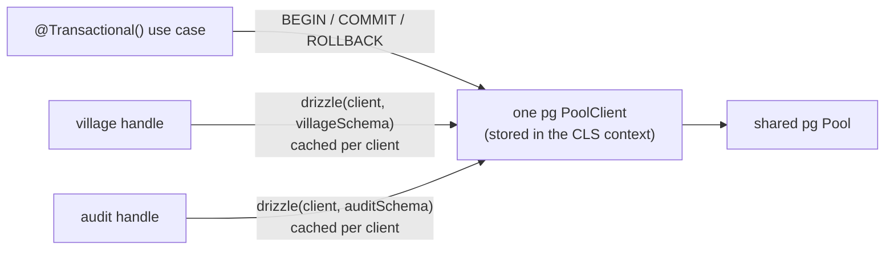

# Database

PostgreSQL 16 with PostGIS, pg_trgm and citext, accessed through Drizzle ORM and node-postgres. This page covers the roles, migrations, how modules declare and query tables, and how the database is tested.

## Roles

Two roles, so that the running API has only the rights it needs ([least privilege](tech-stack.md#two-database-roles-owner-and-qaryati_app)).

| Role                                     | Created by                                                                                    | Used by                           | Rights                                                                               |
| ---------------------------------------- | --------------------------------------------------------------------------------------------- | --------------------------------- | ------------------------------------------------------------------------------------ |
| Owner (`POSTGRES_USER`, `qaryati_owner`) | the postgres image, on first start                                                            | `migrate` service, `npm run db:*` | Owns the database and every table. Creates extensions, tables, indexes.              |
| `qaryati_app`                            | [`docker/postgres/init/20-create-app-role.sh`](../docker/postgres/init/20-create-app-role.sh) | the API (`DATABASE_URL`)          | `CONNECT`; `SELECT, INSERT, UPDATE, DELETE` on tables, `USAGE, SELECT` on sequences. |

What the init script sets up:

- `qaryati_app` is `NOSUPERUSER NOCREATEDB NOCREATEROLE NOREPLICATION NOBYPASSRLS`.
- `PUBLIC` loses every database privilege (`CONNECT`, `TEMP`) and `CREATE` on schema `public`. Only the owner and `qaryati_app` can connect, and only the owner can create objects.
- `ALTER DEFAULT PRIVILEGES FOR ROLE <owner>` grants DML on every table and sequence **the owner creates later**. Each new migration is therefore usable by the API without a manual `GRANT`.
- `TRUNCATE`, `REFERENCES` and `TRIGGER` are not granted, and neither is anything on the `drizzle` schema that records applied migrations.

As a result, `qaryati_app` cannot `CREATE`, `ALTER`, `DROP` or `TRUNCATE` anything (SQLSTATE `42501`). `test/database-roles.int-spec.ts` checks each of these. A table can later take back rights from `qaryati_app` with a `REVOKE` in its migration. For example, the audit trail (#20) will allow only `INSERT` and `SELECT`.

At startup, `DatabaseModule` runs `SELECT current_user` and logs `Connected to PostgreSQL as qaryati_app`. A wrong URL or password stops the app at startup, not at the first request.

In Docker Compose the owner is the image's `POSTGRES_USER`, which is a superuser inside the container. That is needed because `CREATE EXTENSION postgis` requires a superuser. A production database would use a non-superuser owner, with the extensions created once by an administrator.

## Extensions

The baseline migration [`migrations/0000_baseline.sql`](../migrations/0000_baseline.sql) enables:

| Extension | Used for                                                                    |
| --------- | --------------------------------------------------------------------------- |
| `postgis` | `geography(Point,4326)` locations, distances, nearby villages, GiST indexes |
| `pg_trgm` | Typo-tolerant search over Arabic and English names, GIN trigram indexes     |
| `citext`  | Case-insensitive unique emails                                              |

It uses `CREATE EXTENSION IF NOT EXISTS`. The `postgis/postgis` image already creates `postgis` (and a few PostGIS add-ons) in `POSTGRES_DB` on first start, and on any other server the migration creates it.

## Schema per module

Each module declares its own tables in `src/modules/<module>/infrastructure/persistence/schema.ts`. [`drizzle.config.ts`](../drizzle.config.ts) collects them with one glob:

```ts
schema: './src/modules/*/infrastructure/persistence/schema.ts',
```

A new module or table therefore needs no change to a shared file. `profile` owns no tables, so it has no `schema.ts`.

Conventions:

- **Casing.** Drizzle runs with `casing: 'snake_case'`, both in `drizzle.config.ts` and in `DatabaseModule`. Declare properties in camelCase without explicit column names. `displayName: text()` becomes the column `display_name`.
- **Only the owning module edits its `schema.ts`.** Other modules reach the data through the owner's `index.ts` facade. dependency-cruiser rejects imports of another module's internals, `schema.ts` included.
- **Constraints belong in the schema**, not only in application code: `notNull`, `unique`, `check`, foreign keys, partial and GIN/GiST indexes.

## Querying: the module database

[`DatabaseModule`](../src/platform/database/database.module.ts) owns the one connection pool (connected as `qaryati_app`). Each module asks it for a Drizzle handle that knows **only that module's schema**:

```ts
// village.module.ts
import { DatabaseModule } from '../../platform/database/database.module';
import * as schema from './infrastructure/persistence/schema';

@Module({ imports: [DatabaseModule.forFeature(schema)], providers: [DrizzleVillageRepository] })
export class VillageModule {}

// infrastructure/persistence/village-db.ts
export type VillageDb = ModuleDb<typeof schema>;

// infrastructure/drizzle-village.repository.ts
@Injectable()
export class DrizzleVillageRepository {
  constructor(@InjectModuleDb() private readonly db: VillageDb) {}

  findBySlug(slug: string) {
    return this.db.query.village.findFirst({
      where: eq(village.slug, slug),
      with: { names: true },
    });
  }
}
```

`forFeature(schema)` returns a dynamic module that provides the token `MODULE_DB` to the importing module only. `@InjectModuleDb()` injects it, and `ModuleDb<typeof schema>` types it. The handle resolves its connection on every query: the active transaction's client inside `@Transactional()`, the pool otherwise ([Transactions](#transactions)).

Why one instance per module:

- **Relational queries without N+1.** With a schema (tables plus `relations(...)`), `db.query.village.findMany({ with: { names: true } })` loads a village and its names in one SQL statement. A Drizzle instance without a schema has no `db.query` at all, so a module would either write the joins by hand or, worse, query names once per village.
- **Isolation between modules.** A single combined schema would put every table of every module on `db.query`, so any repository could read any module's tables without an import that dependency-cruiser could catch. With `forFeature`, `db.query` has only the module's own tables. Another module's table is a compile error (`db.query.populationRecord` does not exist on `VillageDb`) and `undefined` at runtime. `test/database-module.int-spec.ts` checks both with two fake modules.
- **One pool.** Every handle runs on the same `pg` pool (`PG_POOL`), so the number of connections does not grow with the number of modules. The same test checks that both fake modules send their queries to that one pool.

The query builder (`db.select().from(village).innerJoin(...)`) works as before and keeps the SQL visible; use whichever reads better. Tables from another module are still off limits: reach them through that module's `index.ts`.

### Native SQL

For trigram search, PostGIS and statistics, use Drizzle's `sql` template inside normal queries. Values are sent as parameters:

```ts
db.select()
  .from(village)
  .where(sql`${village.name} % ${term}`);
```

Never build SQL by string concatenation.

## Transactions

A use case marks its transaction boundary with `@Transactional()` ([kernel.md](kernel.md#transactions)). This section explains the design.

### The problem

Each module has its own Drizzle instance with only its own schema (above). Drizzle's `db.transaction(tx => ...)` gives a `tx` object that belongs to one instance, so it knows only that instance's tables. A use case that writes to two modules (a change and its audit entry, for example) cannot do both through one `tx`. A combined schema would fix that but would put every module's tables on every `db.query`, which is exactly the isolation the per-module instances exist for.

### The design: transactions at the connection level



1. `@Transactional()` (from `nestjs-cls` + `@nestjs-cls/transactional`) runs the method through our adapter, [`PgTransactionalAdapter`](../src/platform/database/pg-transactional-adapter.ts). It checks out **one `pg` client** from the shared pool, runs `BEGIN`, and stores the client in the request's CLS context. When the method resolves: `COMMIT`; when it throws: `ROLLBACK`. The client always goes back to the pool (and is destroyed if even `ROLLBACK` failed).
2. Each module still injects **one handle** from `DatabaseModule.forFeature(schema)` ([`module-db.ts`](../src/platform/database/module-db.ts)). On each use the handle asks "is there an active transaction client?" and builds the module's Drizzle instance, with **only that module's schema**, on that client, or on the pool if there is none.
3. Instances are cached per client in a `WeakMap`, so they are not rebuilt per query. The pool reuses its clients, so after warm-up the cache holds one instance per client per module.
4. **Propagation `REQUIRED`:** a `@Transactional()` method called inside another joins the active transaction (one `BEGIN`). Savepoints (`NESTED`) are not supported for now.
5. **After commit:** the transaction carries a queue of callbacks. Domain events wait there and are delivered after `COMMIT`, or dropped on `ROLLBACK` ([kernel.md](kernel.md#domain-events)).

So repositories never receive or pass a `tx`, every module's queries in one use case share one transaction, and `db.query` inside a transaction still shows only the module's own tables. `db.transaction()` on the handle throws, so nobody opens a second, independent transaction by accident.

What `test/transactions.int-spec.ts` proves against real PostGIS: writes of two modules roll back together; relational queries (`findFirst({ with })`) work inside the transaction on the module's own schema; another module's tables stay invisible there (type-level `@ts-expect-error` and runtime); a nested `@Transactional()` joins (one pool checkout, same `txid_current()`); after rolled-back calls the pool's idle count is back where it started; two concurrent requests get different backends and transactions and do not see each other's uncommitted rows. Making the handle ignore the transaction makes four of those tests fail.

Overhead, measured with a micro-benchmark (no database, 200 000 iterations): resolving the handle and fetching the cached instance adds ~0–25 ns per query builder access, within noise of using a Drizzle instance directly; building a new Drizzle instance costs ~2.2 µs, which the cache avoids. A database round trip is hundreds of microseconds, so the handle is not measurable in practice.

### Alternatives considered

| Option                                                                    | Why not chosen                                                                                                                                                                                                                                                                              |
| ------------------------------------------------------------------------- | ------------------------------------------------------------------------------------------------------------------------------------------------------------------------------------------------------------------------------------------------------------------------------------------- |
| A. The official `@nestjs-cls/transactional-adapter-drizzle-orm`           | It wraps `db.transaction()` of one Drizzle instance. With one instance per module, two modules would get two separate transactions (no common rollback). It works only with one instance that has every schema, which breaks module isolation. The adapter's tests would fail test 1 above. |
| B. One combined transaction instance without relational queries           | One schema-less Drizzle instance for transactions: shared, but `db.query` (relational queries) would not exist inside transactions, so modules would write joins by hand or risk N+1 exactly where they write. Kept as the fallback if C had failed.                                        |
| **C. Transactions at the connection level, a handle per module (chosen)** | One transaction for all modules, relational queries everywhere, isolation kept. Cost: an adapter and a handle of our own (~170 lines with comments) (both unit- and integration-tested), and a Proxy in front of Drizzle.                                                                   |

## Migrations

Migrations live in [`migrations/`](../migrations/). Drizzle-kit generates them, they are reviewed like code, and they are applied in order.

| Command                                    | What it does                                                                                   |
| ------------------------------------------ | ---------------------------------------------------------------------------------------------- |
| `npm run db:generate`                      | Compares the `schema.ts` files with `migrations/meta` and writes a new SQL migration.          |
| `npm run db:generate -- --custom --name=x` | Writes an empty migration for hand-written SQL (extensions, data fixes).                       |
| `npm run db:migrate`                       | Applies pending migrations to the database in `DATABASE_OWNER_URL` (the Compose database).     |
| `npm run db:check`                         | Checks that the migration history is consistent (for example after a merge).                   |
| `npm run db:drift`                         | Fails if a `schema.ts` change has no generated migration. CI runs it ([ci.md](ci.md#quality)). |
| `npm run db:studio`                        | Opens Drizzle Studio on the owner connection, for browsing data locally.                       |

All four read `DATABASE_OWNER_URL` from `.env`, so copy `.env.example` first.

Workflow:

1. Change your module's `schema.ts`.
2. `npm run db:generate`, then **read the generated SQL**. Check locks, defaults on large tables and anything irreversible.
3. `npm run db:migrate` against your local Compose database, then run the tests.
4. Commit the schema change, the SQL file and the `migrations/meta` changes together.

Rules:

- **Never edit a migration that is already on `main`.** Fix forward with a new migration.
- If `main` gained a migration while your branch was open: rebase, delete your migration, run `db:generate` again.
- `migrations/meta/` is generated by drizzle-kit and excluded from Prettier, so formatting never changes its content.

How migrations are applied:

- **Compose:** the one-shot `migrate` service runs `node dist/platform/database/migrate.js` from the API image as the owner role, then exits. `api` starts only after it exits successfully.
- **Tests:** `runMigrations()` from the same file.
- Applied migrations are recorded in `drizzle.__drizzle_migrations`, so a second run does nothing. Pending migrations are applied in one transaction: either all of them apply, or none do.

## What the database enforces

The project rule is that the database guards data shape and integrity, while domain code owns business rules. A business rule changing must never require a migration.

1. Primary keys, foreign keys with an explicit `ON DELETE`, and `NOT NULL` on columns that must always exist.
2. Uniqueness that the code cannot guarantee under concurrency, such as a village slug or administrative-unit code.
3. Indexes needed by known queries.

The database does not use `CHECK` constraints for allowed values, ranges, lengths, formats or workflow rules. Those columns are plain `text`, and their allowed values live in module domain code as `as const` arrays with unit tests.

## Cross-module foreign keys

- `village.created_by → user_account.id`, `ON DELETE RESTRICT`, added as raw SQL in the village migration. This constraint is not declared through IAM's Drizzle schema because modules must not import another module's table definitions.

## Testing against the database

Integration and e2e tests use a real PostGIS container through [Testcontainers](https://testcontainers.com/). The database is never mocked (CONTEXT.md).

[`test/support/test-database.ts`](../test/support/test-database.ts) starts the same image as Compose, with the same role init script, and runs all migrations. It returns both URLs:

```ts
const db = await startTestDatabase(); // { ownerUrl, appUrl, stop() }
```

- **Integration tests** (`*.int-spec.ts`) start one container per test file in `beforeAll` and stop it in `afterAll`. Test files stay isolated from each other.
- **E2E tests** (`*.e2e-spec.ts`) share one container per run, started by `test/support/e2e-global-setup.ts`. `AppModule` validates the environment as soon as it is imported, so `DATABASE_URL` must be set before any e2e test file loads.
- A test that needs `ConfigService` without the whole app calls `createAppConfigModule()` after setting `process.env.DATABASE_URL` (see `test/database-module.int-spec.ts`).
- Test tables are created by the owner client, the way a migration would create them, and the code under test uses `qaryati_app`. That keeps the grants under test too. E2E tests find the owner URL in `TEST_DATABASE_OWNER_URL`, set by the global setup (the reference module's `widget` table is created this way and is not in `migrations/`).
- A test that calls `@Transactional()` code without HTTP wraps each call in `cls.run(...)`, the way the CLS middleware opens one context per request (`test/transactions.int-spec.ts`).

Docker must be running. The first run pulls `postgis/postgis:16-3.5`, which takes a while, and later runs need about 10–20 seconds per container.

## IAM credential tables (#14)

IAM owns `user_account` and `refresh_token`. Email uses a local Drizzle citext custom type; the baseline already enables the extension. A full unique index reserves email case-insensitively even for disabled or soft-deleted accounts. The application trims and lowercases email but the database is the uniqueness authority, including concurrent registration.

Accounts use versionColumns(), explicit Clock timestamps, and CHECK constraints for the existing three roles, ACTIVE/DISABLED status and positive version. IDs come from IdGenerator (UUIDv7), not database defaults. No account administration or deletion endpoint is added.

Refresh rows contain a SHA-256 hex digest, user FK (ON DELETE RESTRICT), family UUID, createdAt and expiresAt. Token digests are unique; the user FK is indexed. Raw 256-bit opaque tokens never enter persistence. A CHECK enforces lowercase 64-character hex digests and expiry after creation; the application sets expiry to seven days. Family identity prepares for #18 only: there is no revokedAt, rotation or reuse behavior in #14.
