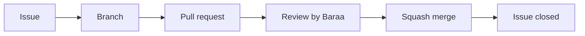

# Git workflow

Every change follows one path:



The aim is traceability. Each line on `main` maps to one pull request, one issue and one author, and Git process is 15% of the grade. GitHub settings enforce the rules below wherever it can, so they do not depend on memory.

## Issues

- `docs/plan/issues.json` holds the plan. `scripts/github-bootstrap.sh` creates the GitHub issues from it. The issues are the source of truth for scope.
- Each issue has an owner, a due date, a phase (milestone), dependencies, acceptance criteria and a definition of done.
- New issues use the **Task** template. Blank issues are disabled (`.github/ISSUE_TEMPLATE/config.yml`) so no issue lacks acceptance criteria.
- Do only what the acceptance criteria ask. Ask before widening scope.

## Branches

`<type>/<issue-number>-<short-slug>`, branched from the latest `main`.

| Prefix     | Use for                     | Example                       |
| ---------- | --------------------------- | ----------------------------- |
| `feature/` | New behaviour               | `feature/23-village-crud`     |
| `chore/`   | Tooling, setup, maintenance | `chore/2-nestjs-skeleton`     |
| `fix/`     | Bug fixes                   | `fix/41-geocode-accept-audit` |
| `docs/`    | Documentation only          | `docs/11-adr-architecture`    |
| `ci/`      | CI workflows                | `ci/4-github-actions`         |

Why: the number links the branch to its issue, and the prefix tells reviewers what kind of change to expect.

## Commits

[Conventional Commits](https://www.conventionalcommits.org/) with the module as scope:

```
feat(village): add slug generation
fix(population): reject negative counts
test(iam): cover refresh-token reuse
chore(platform): add health endpoint
docs: add ADR-003 claims model
ci: cache npm dependencies
```

Scopes: `platform`, `shared`, `village`, `population`, `heritage`, `economy`, `curation`, `audit`, `iam`, `geo`, `profile`, `web`, `deps` (dependency updates). Leave the scope out for repository-wide changes. The list is closed: commitlint (`commitlint.config.mjs`) rejects any other scope, so a typo fails the commit.

Why: readable history, and the scope shows which module a change touches. commitlint checks the format on every commit (#2).

Keep commits focused. Squash merging joins them into one commit on `main`, but reviewers still read them one by one.

## Pull requests

- **One issue per PR.** The body follows `.github/pull_request_template.md` and starts with `Closes #<n>`, so merging closes the issue.
- **The PR title is a Conventional Commit** (`feat(village): add village CRUD`), because it becomes the commit title on `main`.
- Fill in **What**, **Why**, **How it was tested** and **Design decisions**. Lasting decisions also go into the relevant doc or an ADR.
- Aim for about **400 changed lines** at most. Smaller PRs get better reviews.
- Before pushing: `npm run format:check && npm run lint && npm run typecheck && npm run depcruise && npm run test:unit && npm run test:int`. Never disable a check to get green.
- Docs are part of done (see [CONTEXT.md](../CONTEXT.md)). A PR without its docs is not ready for review.
- After merge, move to the next issue from an updated `main`. If `main` gained a migration while your branch was open, rebase, delete your migration and regenerate it.

## Reviews and CODEOWNERS

`.github/CODEOWNERS` lists `@baraafanah21` and `@hamamalkhateeb2005-commits` as owners of every file.

| Who opens the PR         | Who approves | Who merges |
| ------------------------ | ------------ | ---------- |
| Hamam, Momen, Yahya, Ali | Baraa        | Baraa      |
| Baraa                    | Hamam        | Baraa      |

- GitHub never lets the author approve their own PR. Hamam is a code owner **only** so that Baraa's PRs can get the required Code Owner approval.
- GitHub cannot express "Hamam approves only Baraa's PRs" or "only Baraa merges". These are **team rules**. Branch protection still enforces at least one Code Owner approval on every PR.

## Merging

Only **squash merge** is enabled. Each PR becomes one commit on `main`:

- **title** = PR title (a Conventional Commit, with the PR number appended by GitHub)
- **body** = PR body (keeps `Closes #<n>` and the design decisions in history)

Why squash: one commit per issue keeps `main` linear and readable, and work-in-progress commits stay in the PR. Merge commits and rebase merging are disabled so nobody picks a different strategy by accident. Head branches are deleted automatically after merge so stale branches do not pile up.

## Labels

| Group    | Labels                                                                                                                                                                                       | Colour |
| -------- | -------------------------------------------------------------------------------------------------------------------------------------------------------------------------------------------- | ------ |
| Module   | `module:platform`, `module:iam`, `module:village`, `module:curation`, `module:population`, `module:audit`, `module:heritage`, `module:economy`, `module:geo`, `module:profile`, `module:web` | blue   |
| Type     | `type:feature`, `type:chore`, `type:test`, `type:docs`, `type:perf`, `type:security`                                                                                                         | green  |
| Priority | `blocker`                                                                                                                                                                                    | red    |

GitHub's default labels were removed so every label means something in this project.

## Milestones

| Milestone | Phase                                                        | Due (UTC)  |
| --------- | ------------------------------------------------------------ | ---------- |
| G0        | P0 Setup: everyone runs the stack                            | 2026-10-14 |
| G1        | P1 Foundations: auth, sources, audit and schemas merged      | 2026-10-24 |
| G2        | P2 Core features: core endpoints merged                      | 2026-11-07 |
| G3        | P3 Integration and freeze: feature freeze                    | 2026-11-14 |
| G4        | P4 Performance and security: perf report and security review | 2026-11-24 |
| G5        | P5 Docs and submission                                       | 2026-12-01 |
| UI        | Internal web client for the team and the demo; not graded    | 2026-11-28 |

Issues #61–#64 (milestone UI) have no assignee yet. Whoever picks one up assigns it to themselves when they move it to In progress.

## Project board

The GitHub Project **Qaryati** is linked to the repository and has one Status field:

| Status      | Meaning                             | Who moves it                           |
| ----------- | ----------------------------------- | -------------------------------------- |
| Backlog     | Planned; dependencies not finished  | (initial)                              |
| Ready       | Dependencies merged; can be started | Baraa                                  |
| In progress | A branch exists                     | the owner, when starting               |
| In review   | PR open                             | the owner, when opening the PR         |
| Done        | Merged and closed                   | the project's workflows on close/merge |

## Branch protection on `main`

| Setting                                | Value    | Why                                                                                    |
| -------------------------------------- | -------- | -------------------------------------------------------------------------------------- |
| Require a pull request                 | on       | Nothing reaches `main` without review: no direct pushes.                               |
| Required approvals                     | 1        | Every change is seen by a second person.                                               |
| Dismiss stale approvals on new commits | on       | An approval covers exactly the code that is merged, not an earlier version.            |
| Require review from Code Owners        | on       | Baraa (or Hamam, for Baraa's PRs) must approve.                                        |
| Require conversation resolution        | on       | Review comments cannot be ignored.                                                     |
| Require linear history                 | on       | Matches squash-only merging; history stays a straight line.                            |
| Force pushes                           | blocked  | History on `main` is never rewritten.                                                  |
| Deletions                              | blocked  | `main` cannot be deleted by accident.                                                  |
| Enforce for admins                     | on       | The rules apply to the repository owner too.                                           |
| Required status checks                 | none yet | #4 adds the five CI jobs as required checks, with "require branches to be up to date". |

## Repository bootstrap script

`scripts/github-bootstrap.sh` applies everything on this page to GitHub: merge settings, labels, milestones, the 64 planned issues, the project board, branch protection, and closing #1. Configuration as a script can be reviewed, repeated and audited later. Clicks in the UI cannot.

```bash
scripts/github-bootstrap.sh --dry-run          # read current state, print what would change
scripts/github-bootstrap.sh                    # apply
scripts/github-bootstrap.sh --only issues      # one step: settings|labels|milestones|issues|project|protection|close
```

| Property                     | How                                                                                                                                                                                                  |
| ---------------------------- | ---------------------------------------------------------------------------------------------------------------------------------------------------------------------------------------------------- |
| Idempotent                   | Every step reads the current state and changes only what differs. A second run makes no changes.                                                                                                     |
| Issue numbers match the plan | Issues and PRs share one number sequence. Before each create, the next number must equal the planned one. After each create, the returned number is checked again. On any mismatch the script stops. |
| Safe after #4                | The protection step keeps existing required status checks.                                                                                                                                           |
| Late collaborators           | Issues of someone whose invitation is still pending are created unassigned. Run `--only issues` again after they accept.                                                                             |

Run it only after the bootstrap commit is on `main`: branch protection is enforced for admins and rejects direct pushes afterwards. Requires `gh` (scopes `repo`, `workflow`, `project`) and `jq`.

Some settings must be checked by hand in the project's **Settings → Workflows**, because the API cannot set them: "Item closed" and "Pull request merged" set Status to **Done**.

## Who runs Git and GitHub commands

Team members make every commit and run every command that changes GitHub (push, PRs, issues, settings). AI assistants may prepare files and run local checks, but they never commit, push or change GitHub. Every action in the history therefore belongs to a person.
