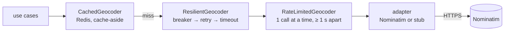

# geo module

**Owner:** Ali · **Issues:** #21, #37, #41

## Responsibility

Geocoding through an external API (Nominatim) behind a port: resilience, cache, suggestions and the accept flow that submits a village location claim.

## Owned data

None. Suggestions are not stored: an accepted candidate becomes a `LOCATION` claim owned by the village module. `infrastructure/persistence/schema.ts` stays empty.

## Geocoding port (#21)

`GeocodingPort` (`application/geocoding.port.ts`, token `GEOCODING_PORT`) is the only way the module talks to a geocoder:

```ts
search({ name, nameAlt?, limit? }, { signal? }): Promise<GeocodeCandidate[]>
// GeocodeCandidate = { displayName, latitude, longitude, provider, providerRef }
```

- `name` is searched first; `nameAlt` (usually the English name) only when `name` finds nothing. `limit` is 1–10, default 5.
- An empty array means "nothing found". Every failure is one of two errors from `domain/geocoding-errors.ts`, both 502 through the kernel's `UpstreamError` category ([errors.md](../../../docs/errors.md#geocoding-unavailable)):

| Error                       | Code                     | When                                                                                                                 |
| --------------------------- | ------------------------ | -------------------------------------------------------------------------------------------------------------------- |
| `GeocodingUnavailableError` | `GEOCODING_UNAVAILABLE`  | timeout, network error, any HTTP error status. `transient` is true for timeouts, network errors and 502/503/504 only |
| `GeocodingBadResponseError` | `GEOCODING_BAD_RESPONSE` | malformed JSON, a body that does not match the schema, coordinates out of range                                      |

The provider's body never reaches the client or the error message: an error status is dropped unread, and a JSON syntax error is thrown without its cause, because its message quotes the body.

### Adapters

`GEO_PROVIDER` picks the adapter in `geo.module.ts` ([configuration.md](../../../docs/configuration.md#geocoding)).

| Adapter                     | When                                     | What it does                                                                                                                                                                                                                               |
| --------------------------- | ---------------------------------------- | ------------------------------------------------------------------------------------------------------------------------------------------------------------------------------------------------------------------------------------------ |
| `StubGeocodingAdapter`      | `stub`, the default (dev, tests, CI, k6) | Fixed fixtures for six villages (Lifta, Deir Yassin, Battir, Sebastia, Beit Furik, Ein Karem), matched by `normalizeName` on their Arabic or English name. No network, same answer every time.                                             |
| `NominatimGeocodingAdapter` | `nominatim`                              | Node 24 `fetch`: `GET {GEO_NOMINATIM_URL}/search?q=&format=jsonv2&limit=&countrycodes=ps,il&accept-language=ar,en`, header `User-Agent: {GEO_USER_AGENT}`. The answer is validated with zod (`lat`/`lon` strings → range-checked numbers). |

- **Why `countrycodes=ps,il`:** many of the villages this project documents were depopulated in 1948 and lie inside today's Israel. Searching `ps` alone would miss them; searching worldwide would return same-named places in Syria, Lebanon or Jordan.
- **Why `accept-language=ar,en`:** the display names come back in Arabic when OpenStreetMap has them, which matches the village names editors compare against.
- **User-Agent:** Nominatim's usage policy requires one that identifies the application. The config schema requires `GEO_USER_AGENT` with `GEO_PROVIDER=nominatim` and rejects any value containing `@`: a generic project agent, never a personal email.
- **Timeout:** without a caller signal, one search aborts after `GEO_TIMEOUT_MS`; behind the decorators, the resilience layer passes its own per-attempt signal.

## Resilience and cache (#37)

The use cases see one `GEOCODING_PORT`. `geo.module.ts` builds it by wrapping the adapter in three decorators (`infrastructure/`), each tested on its own, so the provider stays replaceable and every policy lives in one place:



The cache is outermost, so a hit costs neither rate limit nor breaker budget. The rate limiter is innermost, so every retry waits for its turn too. **The stub skips the rate limiter** (one request per second is Nominatim's policy, and k6 and the e2e tests must not be throttled by fixtures); retry, breaker and cache wrap every provider. All values are configuration ([configuration.md](../../../docs/configuration.md#geocoding)).

| Policy          | Value (default)                                                                                                                                                                                  | Why                                                                                                                                                                                                                                                                                                                      |
| --------------- | ------------------------------------------------------------------------------------------------------------------------------------------------------------------------------------------------ | ------------------------------------------------------------------------------------------------------------------------------------------------------------------------------------------------------------------------------------------------------------------------------------------------------------------------ |
| Timeout         | `GEO_TIMEOUT_MS` = 5000 per attempt, cooperative (the `fetch` is aborted)                                                                                                                        | A geocoder that takes longer is effectively down; an editor waits at most about three attempts.                                                                                                                                                                                                                          |
| Retry           | at most 2 retries, exponential backoff with jitter from `GEO_RETRY_BASE_MS` = 200                                                                                                                | **Only transient failures**: timeouts, network errors, 502/503/504. They are usually gone a moment later. Jitter keeps retries from arriving in step.                                                                                                                                                                    |
| No retry        | 429, other 4xx, 500, `GEOCODING_BAD_RESPONSE`                                                                                                                                                    | Retrying a rate limit makes it worse (and can get us blocked). A 4xx is our request's fault, a 500 is a provider bug, and a malformed body is not going to fix itself: retrying only multiplies the load and the wait.                                                                                                   |
| Circuit breaker | opens after `GEO_BREAKER_THRESHOLD` = 5 consecutive failed calls; half-open after `GEO_BREAKER_HALF_OPEN_MS` = 30000                                                                             | While the provider is down, failing at once (502 "temporarily disabled") is kinder to editors and to the provider than five-second timeouts. After 30 s one trial call goes through; a success closes the breaker. Counts calls, not attempts. Logged once per change: `warn` on open, `info` on close, no request data. |
| Rate limit      | one call at a time, `GEO_MIN_INTERVAL_MS` = 1000 between starts; a caller waits at most `GEO_QUEUE_TIMEOUT_MS` = 5000                                                                            | Nominatim's usage policy allows one request per second. A caller that would wait longer gets a non-transient 502 ("busy") instead of a hanging request, and the retry layer does not requeue it.                                                                                                                         |
| Cache           | key `geo:v1:` + SHA-256 of `{ provider, normalizeName(name), normalizeName(nameAlt), limit }`; results `GEO_CACHE_TTL_SECONDS` = 30 days, empty results `GEO_CACHE_EMPTY_TTL_SECONDS` = 24 hours | Places do not move, so results can live long; an empty answer may change when OpenStreetMap is edited, so it expires sooner. Spellings that `normalizeName` treats as equal (`Beit Furik`, `beit  furik`) share one entry. The hash keeps names out of Redis keys. Provider errors are never cached.                     |

- **Redis down:** the cache uses the one shared client (`REDIS`, `enableOfflineQueue: false`). A failed read falls through to the provider, a failed write is logged at `warn` and ignored. A Redis outage costs speed and rate-limit budget, never a request.
- **One instance:** the rate limiter and the breaker are in process. That is right for this project's single API instance. With several instances each would allow one request per second and keep its own breaker; the next step would be a shared limiter in Redis (a token bucket in a Lua script, like the API rate limiter in `src/platform/rate-limit`).
- **Swapping the provider:** write a new adapter that implements `GeocodingPort` and maps its failures to the two geo errors (with `transient` set honestly), add its name to `GEOCODING_PROVIDERS`, `GEO_PROVIDERS` and `geocodingSources()`, and choose it in `createGeocoder`. The decorators, the cache key and the endpoints do not change.

## Suggestions and accept (#41)

Both endpoints are for editors (`EDITOR` or `ADMIN`).

| Endpoint                                                | Answer                                                                                                                                                                                                                                                                                                                                                                                                                                                                                                                                                          |
| ------------------------------------------------------- | --------------------------------------------------------------------------------------------------------------------------------------------------------------------------------------------------------------------------------------------------------------------------------------------------------------------------------------------------------------------------------------------------------------------------------------------------------------------------------------------------------------------------------------------------------------- |
| `POST /api/v1/villages/{id}/geocode-suggestions`        | `200 { candidates }`. Searches the village's preferred Arabic name (the `display_name_ar` projection), then its English name. 404 for an unknown village; 502 when the provider fails or the breaker is open. Nothing is stored. No transaction: an external call never holds one.                                                                                                                                                                                                                                                                              |
| `POST /api/v1/villages/{id}/geocode-suggestions/accept` | Body: one candidate (strict). `201` with the new `LOCATION` claim, `ETag` = claim version. In one transaction: curation's `SourceWriter.findOrCreateExternalApiSource` (the provider's `EXTERNAL_API` source, created and audited on first use), then village's `VillageFactWriter.submitLocation` with precision `APPROXIMATE`, `sourceLocator` = `providerRef`, `description` = `displayName` (audited as `claim.submitted`). The claim is `UNVERIFIED`: another editor must verify it (four eyes). The same candidate twice is a 409 (`claim_no_duplicate`). |

Geo never touches village or curation tables: both writes go through the owners' facades.

**Change to #41: no queue and no stored suggestion list.** The issue planned a BullMQ worker that geocodes in the background and stores suggestions for a later `GET`. The call is triggered by an editor and rare, and the rate limiter, cache and breaker already give the guarantees the queue was for (one request per second, no hammering of a failing provider, fast repeats). A synchronous `200` is also simpler for the client than `202` plus polling. A queue is the next step at scale: bulk geocoding of every village, or several API instances sharing one provider budget. ADR-005 (#46) records the geocoding integration as a whole.

The rest of the API never depends on the provider: only the suggestions endpoint calls it, so with the provider down or the breaker open, `GET /villages` and the profile keep answering 200 (an e2e test proves it).

## Public API (`index.ts`)

Nothing: no other module calls geo.

## Dependencies

| Direction                         | Modules                      |
| --------------------------------- | ---------------------------- |
| May import (besides `src/shared`) | `iam`, `curation`, `village` |
| Imported by                       | none                         |

dependency-cruiser enforces these directions (`module-dependency-direction`), and other modules may reach this one only through `index.ts` (`no-cross-module-internals`). See [docs/architecture.md](../../../docs/architecture.md).

## Tests

All HTTP tests use nock with `disableNetConnect()`; CI has no internet.

- `infrastructure/resilient-geocoder.spec.ts` (real adapter + nock, real time with tiny delays: `fetch`, nock and cockatiel each schedule timers, and faking them makes the tests hang): 503 then success → one retry; 429, 400, 500, bad shape → one call, no retry; timeout → three attempts then `GEOCODING_UNAVAILABLE`; five failures open the breaker and the sixth call fails without reaching the provider; after the half-open delay a successful trial closes it.
- `infrastructure/rate-limited-geocoder.spec.ts` (Jest fake timers): three simultaneous calls start at 0, 1000 and 2000 ms; a slow call delays the next; a call that would wait past the queue timeout fails without calling the provider; a caller that gives up does not let the next one overtake.
- `test/geo/geocoding-cache.int-spec.ts` (real Redis from Testcontainers): the second identical call is served from Redis; spellings share a key; TTLs of full and empty results; errors are not cached; with the client disconnected the call still returns the provider's answer.
- `test/geo/geocode-suggestions.e2e-spec.ts` (stub provider): suggestions 200 / 401 / 403 / 404, `nameAlt` fallback; accept 201 with an `UNVERIFIED` `APPROXIMATE` claim and an `EXTERNAL_API` source, audit entries, one source for every accept, 409 on a repeat, 400 on a bad body; with a failing provider double the breaker opens after five 502s, the sixth 502 never reaches the provider, and `GET /villages` and the profile still answer 200.
- `infrastructure/nominatim-geocoding.adapter.spec.ts` (nock, `disableNetConnect`): success mapping, empty result, `nameAlt` fallback, malformed JSON, wrong shapes, 503, 429/500/400, timeout, network error, missing User-Agent. The timeout case uses a local server that never answers, because nock's delayed mock socket trips an undici assertion when `fetch` aborts it.
- `infrastructure/stub-geocoding.adapter.spec.ts`, `geo.module.spec.ts` (provider selection).

## Layout

| Folder            | Holds                                                                          |
| ----------------- | ------------------------------------------------------------------------------ |
| `web/`            | `GeocodeController` and its zod schemas                                        |
| `application/`    | Use cases (suggest, accept) and the geocoding port                             |
| `domain/`         | Geocoding errors; plain TypeScript, no framework                               |
| `infrastructure/` | Adapters (Nominatim, stub) and the cache, resilience and rate-limit decorators |
